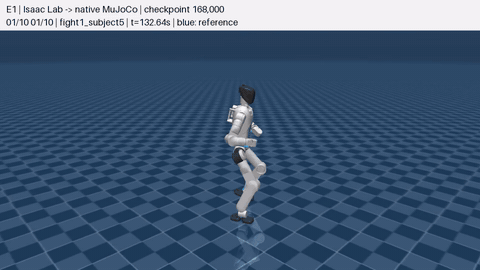
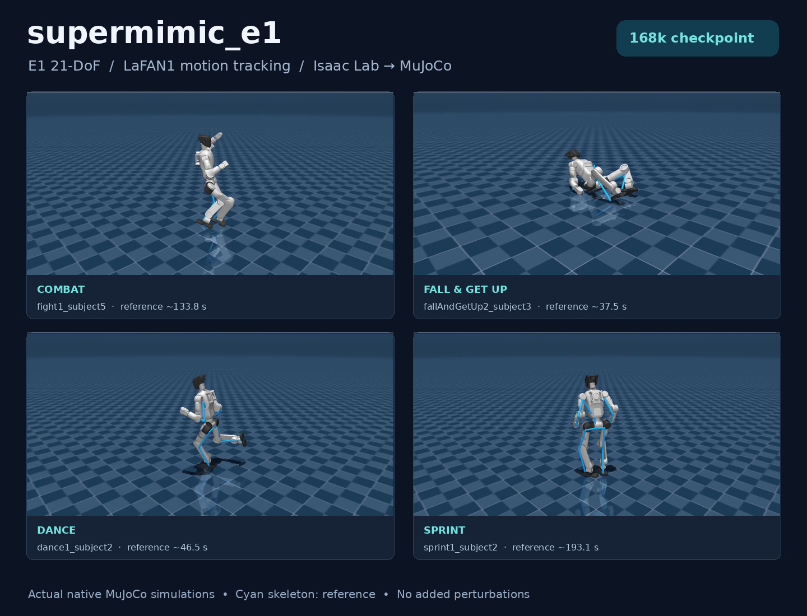
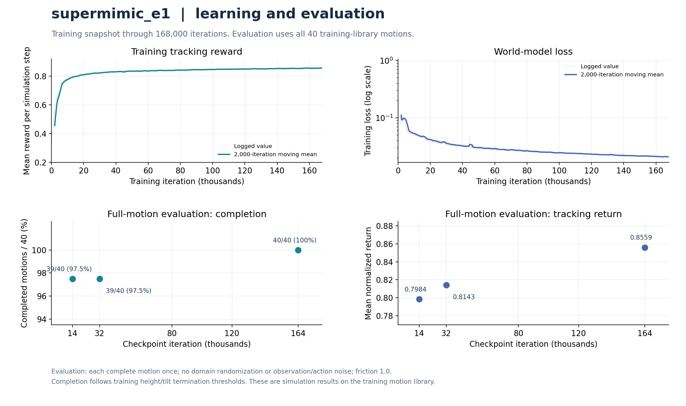

# SuperMimic_E1

面向 **DroidUp E1 21 自由度机器人**的 SuperMimic 非官方复现与 sim2sim 工程。训练沿用
**Isaac Lab 3 + Newton / MuJoCo-Warp**，训练后的策略可在独立的 **原生 MuJoCo**
中运行。

[环境安装](install.md) · [80 秒随机动作视频](docs/assets/e1_random10_80s.mp4) ·
[完整评测记录](docs/results/eval_164000_summary.json) · [来源与许可](THIRD_PARTY_NOTICES.md)



实体机器人由训练策略控制，蓝色骨架为参考动作。动画与下方视频均来自实际 E1
sim2sim；展示模型为第 **168000** 轮。训练、视频与完整评测的版本分别记录，便于复现。

## 项目内容

- E1 的 21 维动作、75 维单帧观测与 10 帧历史；未来 10 帧参考目标共 570 维。
- 一个共享策略跟踪 40 条 E1 LaFAN1 动作，包含舞蹈、跌倒起身、格斗、跳跃、
  跑步、冲刺与行走等 8 类。
- 原训练流程的世界模型、想象轨迹策略优化、价值网络和自适应片段采样。
- sim2sim 使用 CPU 策略推理、50 Hz 控制、200 Hz MuJoCo 物理步进，以及
  与训练一致的关节顺序、动作缩放、PD、力矩限制和 pelvis 观测约定。
- 支持指定动作、随机时间起点、交互查看、无窗口验证，以及随机片段合成视频。



## 已测结果

以下是保存下来的实验快照，不随后台训练自动更新。

| 评测项 | 检查点 | 结果 | 记录 |
| --- | ---: | --- | --- |
| Isaac Lab：40 条完整动作 | 14000 | 完成 39/40，归一化回报 0.7984 | [JSON](docs/results/eval_014000_summary.json) |
| Isaac Lab：40 条完整动作 | 32000 | 完成 39/40，归一化回报 0.8143 | [JSON](docs/results/eval_032000_summary.json) |
| Isaac Lab：40 条完整动作 | **164000** | **完成 40/40（100%），归一化回报 0.8559** | [JSON](docs/results/eval_164000_summary.json) |
| 原生 MuJoCo：10 个随机片段 | **168000** | **10/10 完成，每段 8 秒，总长 80 秒** | [抽样](docs/results/random10_sampling_plan.json) · [统计](docs/results/random10_summary.json) |

完整动作评测在训练动作库内进行，每条从参考初始状态运行到末尾，关闭随机扰动
与观测、动作噪声，以高度或倾斜终止阈值判断失败。随机片段评测从各自抽中的参考
状态独立初始化。以上完成率分别对应各自协议，不代表未见动作的泛化指标。



图中训练跟踪奖励、世界模型损失与独立动作完成率分开绘制。训练 CSV 快照截至
168000 轮，见 [train_log.csv](docs/results/train_log_168000.csv)。

## 安装与资源

完整步骤见 **[install.md](install.md)**，提供两条安装路径：

1. `.venv-isaaclab3`：训练、USD 转换与 Isaac Lab 评测。
2. `.venv-sim2sim`：CPU 策略推理、原生 MuJoCo 与录屏；通过
   `SUPERMIMIC_PYTHON` 指定解释器。

本地整理目录已经放好 `datasets/e1_lafan/*.csv` 和 `models/ckpt_168000.pt`。它们被
`.gitignore` 排除；GitHub 克隆后需按安装文档放入自己的 E1 动作数据与检查点，
或训练生成检查点。机器人 MJCF / URDF / meshes 随代码目录提供。

## 快速开始：sim2sim

安装后，在本项目根目录执行。若使用训练环境，启动脚本默认选择
`.venv-isaaclab3/bin/python`；若使用最小仿真环境，先设置：

```bash
export SUPERMIMIC_PYTHON="$PWD/.venv-sim2sim/bin/python"
```

打开交互窗口：

```bash
bash run_e1_sim2sim.sh --checkpoint models/ckpt_168000.pt \
  --motion dance1_subject2
```

空格暂停，`R` 从所选参考时间重置，`Esc` 关闭窗口。

无窗口仿真并保存测量结果：

```bash
bash run_e1_sim2sim.sh --checkpoint models/ckpt_168000.pt \
  --headless --motion fallAndGetUp1_subject1 --seconds 20 \
  --report results/fall_and_get_up.json
```

录制 960×540、25 fps 的 MP4：

```bash
bash run_e1_sim2sim.sh --checkpoint models/ckpt_168000.pt \
  --motion dance1_subject2 --start 40 --seconds 8 \
  --video results/dance_8s.mp4 --report results/dance_8s.json
```

`--start` 为动作中的秒数；不传 `--seconds` 时运行整条动作。`--list_motions`
列出可用动作，`--no_reference` 隐藏蓝色骨架。录像使用 EGL；纯无窗口仿真不创建
渲染上下文。原生 MuJoCo 与训练仿真器的结果分别测量。

### 随机 10 个片段，合成一个 80 秒视频

```bash
bash run_e1_montage.sh --checkpoint models/ckpt_168000.pt \
  --scope total --samples 10 --seconds 8 --seed 20261023 \
  --output_dir results/lafan1_random10
```

默认从整个动作库选择 **10 个不同动作文件**，每个文件随机抽取 **8 秒**，
总时长 **80 秒**。`sampling_plan.json` 在仿真前保存动作、随机起点、种子与文件
哈希；同一命令可复现。视频逐段显示动作名和参考时间。

合成器保留所有抽中片段。若触发跟踪终止，会在画面中用红色标出，并继续模拟完
所选 8 秒；统计中仍记为失败。`summary.json` 区分“已模拟完整时长”和“未触发
终止”。单段日志与视频保存在 `clips/`，最终文件为
`lafan1_random_8s_montage.mp4`。

观看本项目已录制的结果：**[E1 随机 10 段，80 秒 MP4](docs/assets/e1_random10_80s.mp4)**。

## 训练与评测

先按照安装文档转换 USD，然后执行：

```bash
# 选择新的运行名；启动器会拒绝覆盖已有实验。
unset SUPERMIMIC_PYTHON
bash run_e1_train.sh e1_paper
tail -f logs/e1_paper/stdout.log

# 对最新编号检查点运行完整 40 条动作评测。
bash run_e1_eval.sh logs/e1_paper

# 从包含优化器状态的 last.pt 恢复到新目录。
bash run_e1_train.sh e1_resume --resume logs/e1_paper/last.pt
```

编号检查点每 2000 轮保存一次；`last.pt` 还包含优化器状态。评测摘要写入
`logs/<run>/eval_<iteration>_summary.json`。本地参考编号检查点用于推理与评测，
恢复训练应使用原实验的 `last.pt`。

主要训练参数：

| 参数 | 默认值 |
| --- | --- |
| 并行环境 / 总迭代 | 4096 / 320000 |
| 回放缓冲区 | 每环境 1000 步 |
| 世界模型更新 | 10 × 2048 个窗口，窗口长 8 |
| 策略批量 / 想象轨迹长度 | 4096 / 32 |
| 历史 / 目标帧数 | 10 / 10 |
| Critic | 5 epochs × 4 minibatches |
| 学习率 | 2e-4，250000 轮 cosine 衰减至 0.03 倍 |
| Gamma / GAE lambda / UTD | 0.99 / 0.95 / 0.4 |
| 动作噪声标准差 | 0.1 |
| 精度 / 额外 WM-only 阶段 | FP32 + TF32 / 0 轮 |

## 目录

```text
supermimic_e1/
├── README.md
├── install.md
├── requirements-sim2sim.txt
├── requirements-dev.txt
├── supermimic/             # 世界模型、策略、MDP、Isaac Lab 环境
├── tools/                  # 数据验证、USD 转换、sim2sim、随机片段录屏
├── tests/                  # MuJoCo 状态约定、执行器映射与接触测试
├── robots/
│   └── e1_21dof/           # E1 MJCF、URDF 与网格
├── datasets/
│   └── e1_lafan/           # 本地 E1 动作 CSV，Git 默认忽略
├── models/                 # 本地参考检查点，Git 默认忽略
├── docs/assets/            # E1 GIF、效果图、训练曲线与 MP4
├── docs/results/           # 脱敏评测快照与抽样记录
├── run_e1_train.sh
├── run_e1_eval.sh
├── run_e1_sim2sim.sh
└── run_e1_montage.sh
```

## 检查

```bash
# 使用你安装好 PyTorch / MuJoCo 的解释器。
python -m pytest -q tests/test_sim2sim.py
python tools/check_motion.py --robot e1
```

开发与绘图依赖见 `requirements-dev.txt`。这些检查覆盖有旋转和非零速度时的
pelvis 状态往返、按关节名映射的执行器与力矩限制、保留地面接触，以及运动学与
参考数据的维度一致性。


## 致谢与许可

本项目基于 SuperMimic 非官方复现整理，保留原始 [MIT 许可证](LICENSE) 与作者归属。
E1 机器人描述、LaFAN1 动作与展示媒体的来源说明见
[THIRD_PARTY_NOTICES.md](THIRD_PARTY_NOTICES.md)。
